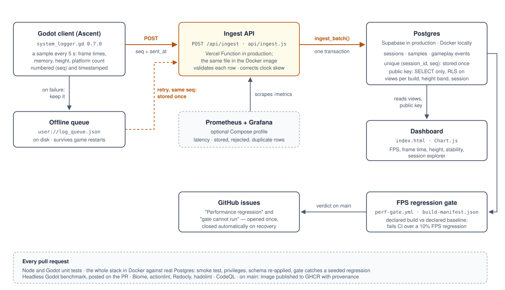

# DevInsight Dashboard

Live performance telemetry pipeline for my Godot game, **Ascent**. Every 5 seconds the running
game reports FPS and memory usage to a Postgres backend, which a live dashboard charts in real
time. Two independent CI gates watch for regressions: one reads real player telemetry for the
build a commit declares, the other runs a deterministic headless benchmark on every single push
and PR so a regression signal exists even before any human has played the build.

**Pipeline:** Godot (`godot/system_logger.gd`) → `POST /api/ingest` (Vercel Function) → Supabase
(Postgres) → `index.html` dashboard (Chart.js) → GitHub Actions performance gate on every push.

10% FPS regression.">

The dashboard supports 5-minute through 24-hour query windows, build filtering and baseline
comparison, deploy/build markers, and a clickable performance-event timeline. Its headline
metrics emphasize tail behavior (P95 frame time and 1% low FPS) rather than relying only on an
average that can hide stutters. Build status is derived from explicit healthy, warning, and
regression thresholds.

## Notable engineering decisions

**Offline retry queue.** If the game can't reach Supabase (dropped connection, brief outage),
data points aren't silently lost — they queue locally on disk. On reconnect, the entire backlog
is sent as a single bulk insert rather than trickling out one row every 5 seconds, so a long
outage doesn't leave live gameplay data stuck behind a slow-draining queue.

Building this surfaced three real bugs worth mentioning:
- **A blocking design flaw**: the first version prioritized flushing the backlog over collecting
  new data, so as long as anything was queued, fresh telemetry stopped being gathered entirely.
  Fixed by giving the flush its own independent request instead of sharing one with live sends.
- **A JSON type-coercion bug**: entries that round-tripped through the local disk queue failed to
  re-insert into Postgres (`22P02: invalid input syntax for type integer`). Godot's JSON parser
  doesn't distinguish `60` from `60.0` — every number becomes a float on parse — so a queued FPS
  value silently drifted from an int to a float and got rejected by Postgres's `integer` column
  on the way back out. Fixed by explicitly re-casting on load.
- **A lost-write race in the queue itself**: the flush serialized the queue, sent it, and on
  success called `queue.clear()`. But the 5-second timer keeps running during that request, so a
  live send failing mid-flight appended new entries to the same queue — and `clear()` then
  deleted rows that had never been transmitted. The offline queue was silently losing exactly
  the data it exists to protect. Fixed by tracking how many entries the in-flight request
  actually carried and removing only those, with the trim logic taught not to disturb rows that
  are spoken for.

**Measuring frame time, not frames per second.** Tail metrics like P95 frame time and 1% low
only mean something over *per-frame* data. Sampling `Engine.get_frames_per_second()` once every
five seconds gives an already-smoothed average, in which a single 200 ms hitch — the exact thing
those metrics exist to catch — is mathematically invisible. From build 0.4.0 the logger
accumulates every frame's delta in `_process` and reports the interval's true P95 and worst
frame alongside the FPS reading. Rows from older builds have no such data, so the dashboard
falls back to the old approximation and labels it as an approximation rather than presenting
both under the same name.

> Caveat worth knowing: with vsync on, frame times floor at the display's refresh interval, so a
> build that got twice as fast reads identically to one that did not. Frame-time *regressions*
> are still visible; headroom above the refresh rate is not.

**CI performance gate.** `.github/workflows/perf-gate.yml` runs the unit tests, then
`scripts/check-regression.mjs`, on every push and pull request to `main`.

The gate is anchored to [`build-manifest.json`](build-manifest.json), which declares the build
this commit produces and the baseline it must be measured against. The script first checks that
`godot/system_logger.gd` really stamps that version, then queries telemetry for exactly those two
builds. That anchoring is the whole point:

- Ordering by "most recently seen" made *replaying an old build* silently invert the comparison,
  so a regression could report as an improvement.
- A gate reading whatever data happens to be in the table at push time is a gate on the clock,
  not on the commit. Anchoring it to a declared build makes it a gate on this code.
- A build with too few samples, or none yet, reports **pending** rather than passing. A green
  check that means "I couldn't tell" is how a real regression ships.

A regression over 10% fails the check; a dip over 5% warns.

## The headless benchmark gate

`check-regression.mjs` (above) has a structural limitation: it can only judge a build once a
human has played it enough to produce real telemetry. Until then it correctly reports
`PENDING` rather than a false pass — but that also means a regression introduced in a commit
sits unjudged until someone happens to play that exact build.

`.github/workflows/benchmark-gate.yml` closes that gap by generating its own performance signal
for the current commit, on every push and every pull request, with no human required:

1. `godot/benchmark/benchmark_scene.gd` runs headless — a fixed-seed, original workload (an
   obstacle-density climber, structurally similar to a procedural platformer's spawn-ahead /
   cull-behind pattern) — and measures the real wall-clock cost of one simulated tick's work,
   1800 times.
2. `scripts/run-benchmark.mjs` runs that three times and keeps the **minimum** P95 tick time
   across trials, not a single sample. Measured empirically: a single trial's P95 swung by
   dozens of percent run-to-run from OS scheduling noise alone. Taking the minimum across
   repeated trials is standard practice for exactly this reason — scheduling noise can only
   ever *add* delay on top of the real cost, never subtract from it, so the minimum is the
   least noise-contaminated estimate of what the code actually costs.
3. That number is compared against [`godot/benchmark/baseline.json`](godot/benchmark/baseline.json),
   a deliberately-committed golden file (`npm run benchmark:update-baseline` regenerates it; the
   gate itself never touches it) — a regression over 30% fails the check, a dip over 15% warns.

**What this does and does not prove.** The workload is original code, not a copy of Ascent's
real level generator — the actual game lives outside this repository by design (see
`CLAUDE.md`), so nothing proprietary needs to become public for CI to measure something real.
That means this gate catches a regression in *this benchmark's own logic* or in Godot/the CI
runner itself — not a regression in Ascent's actual level generation, player physics, or
rendering, none of which exist in this checkout. It also runs headless, so it measures CPU-side
cost only; a purely GPU-bound regression (too many draw calls, an expensive shader) would not
show up here, or in any headless benchmark of the real game either. Both limits are stated
outright in the benchmark script's own header, not left for a reader to discover.

```sh
npm run benchmark                  # run 3 trials, compare against the committed baseline
npm run benchmark:update-baseline  # run 3 trials, OVERWRITE the baseline — review before committing
```

## Stack

- **Godot** — game client, posts telemetry via `HTTPRequest`
- **Vercel Functions** — `api/ingest.js`, the only write path into the database
- **Supabase** — Postgres, RLS-locked anon key (**read-only**)
- **Vercel** — static dashboard hosting
- **GitHub Actions** — unit tests, the real-telemetry regression gate, and the headless benchmark gate
- **Docker** — the whole pipeline on one machine, no accounts needed (see below)

## The ingest API

`POST /api/ingest` is the only way telemetry enters the database. Its full contract — every
field, limit, status code and the client's retry rules — is in [`openapi.json`](openapi.json)
(OpenAPI 3.1), rendered at [`/docs/api.html`](docs/api.html). The document cannot quietly drift
from the code: [`lib/openapi.test.mjs`](lib/openapi.test.mjs) probes the real validator with every
documented bound (accepted at the edge, rejected just past it), compares documented patterns to the
validator's own, requires the documented example to be accepted in full, and reads the handler's
source to check that the documented status codes are exactly the ones it can send. Changing a
limit in one place and not the other fails `npm test`; Redocly lints the document itself in CI.

```json
{
  "session": { "id": "<uuid v4>", "build_version": "0.7.0", "platform": "macOS" },
  "sent_at": "2026-10-16T12:00:05.120Z",
  "samples": [
    { "seq": 41, "created_at": "2026-10-16T12:00:00.004Z", "fps_rate": 60, "memory_used_mb": 92.4,
      "frame_time_p95_ms": 18.2, "frame_time_max_ms": 51.0, "frames_sampled": 300 }
  ]
}
```

The response reports `accepted`, `rejected` (with reasons), `duplicates` (already stored by an
earlier attempt) and `clock_offset_ms` (how far the client's clock is from the server's).

**Why it exists.** The game used to write to Supabase directly with the anon key — a key that
ships inside the game binary *and* inside the dashboard's JavaScript. "Anyone who has opened the
dashboard can write anything to the telemetry table" was therefore load-bearing, and the table it
guarded is the one the CI performance gate reads. Moving writes behind this endpoint does not
make the client credential secret; nothing shipped in a binary is. It changes what that
credential *can do*: append a validated sample to its own session, rather than write arbitrary
rows. The key with real write power now exists only in server-side environment variables.

**Design decisions worth defending:**

- **`build_version` comes from the session, never the sample.** One session is one build by
  definition. Letting each row carry its own version would let a client scatter measurements
  across builds it never actually ran.
- **Partial acceptance.** A batch with one malformed row is accepted, minus that row, and the
  rejection is reported back. Rejecting the whole batch would make it a *poison pill*: the
  offline queue retries anything that is not a success, so a single bad row would be retried
  forever, never drain, and take every good row in the batch down with it.
- **4xx and 5xx mean different things to the client.** A 5xx is re-queued for retry; a 4xx is
  dropped, because a payload the server judges malformed will be judged malformed every time.
  A database failure is therefore a 502, not a 400 — misreporting it would silently discard
  good telemetry.
- **Clean exits are reported; crashes are inferred.** The client says "I ended cleanly" on the
  way out, and the server records a session that simply stops reporting as `abandoned`. A
  crash, by definition, never reaches the shutdown handler — so the accurate signal is the
  *absence* of one, which a dying client cannot falsify.

### Delivery guarantees (0.7.0+)

A network cannot promise "once". When a request times out after the database has already
committed it, the client cannot tell that from a request that never arrived, so it re-sends — and
before 0.7.0 every sample in that batch was stored twice, quietly inflating the averages the CI
gate reads. Three changes, each closing a specific gap:

- **All or nothing.** The ingest function used to make three separate database calls (session,
  samples, events). If the third failed, the first two stayed committed, the client got a 5xx and
  retried everything. Now one call to `ingest_batch()`, a Postgres function, does all three in
  one transaction.
- **Exactly once.** The game numbers every sample and event per session (`seq` 0, 1, 2, ...), and
  `(session_id, seq)` is unique, so a retry of something already stored is skipped and reported
  as a duplicate. The same numbers make loss visible: a session whose highest `seq` is 41 but
  which has 39 rows lost three samples on the way, shown as `samples_lost` in `session_summary`
  and in the session explorer. Older clients send no `seq`; their rows are unaffected.
- **Correct times without trusting the player's clock.** Before 0.7.0 the game sent no sample
  timestamps at all, so the server stamped arrival time — and the offline queue, whose whole job
  is to preserve data through an outage, flushed every queued sample onto a single instant. Now
  each sample carries `created_at` from when it was taken, and each request carries `sent_at`
  from the same clock. The server dates a sample as *its own* now minus the gap between the two,
  so a player whose clock is hours wrong still gets correct timestamps (instead of having every
  sample rejected as "in the future").

Measured with a load test ([`loadtest/RESULTS.md`](loadtest/RESULTS.md)): at 400 requests/second
(~2,000 concurrent players) on a 2-CPU VM, the three-call version fell behind in two of three runs
(p95 131 ms and 508 ms, hundreds of requests dropped); the one-call version held p95 ≤ 7.3 ms with
nothing dropped in all three, and stored zero duplicate rows. The first single before/after pair
had suggested a 25× speed-up; repeated, alternated runs showed that was noise, and the write-up
says so.

### Gameplay correlation (0.6.0+)

A frame-rate chart can only tell you that something got slower. It cannot tell you *where* in
the game, or why. So each performance sample now carries the gameplay context it was taken in —
height climbed, live platform count, total node count, lava speed — on the same row as the frame
timings, which makes correlating them a plain column comparison rather than a join.

Two views turn that into answers:

- **`build_perf_by_height`** buckets samples into 500-unit height bands per build and reports
  frame time beside average platform count. "Frame time doubles above 4000 and platform count
  triples in the same band" is a bug report with a place to start; "FPS went down" is not.
- **`death_distribution`** buckets deaths the same way. A death band that shifts between builds
  is a difficulty change; one that lines up with a frame-time cliff is a performance problem
  costing players runs.

The integration is deliberately one-directional. The logger holds a single `Callable` and knows
nothing about Ascent:

```gdscript
SystemLogger.register_context_provider(_telemetry_context)
SystemLogger.log_event("death", Score.get_current_height(), {"cause": "lava"})
```

Everything game-specific lives in the game. A provider that throws, returns the wrong type, or
touches a freed node degrades to "no context for this sample" — telemetry is a bolt-on, and it
does not get to break the thing it is measuring. The real call sites are recorded in
[`godot/examples/instrumentation.gd`](godot/examples/instrumentation.gd), since the game itself
lives outside this repository.

Event types are a closed set (`run_start`, `run_end`, `death`, `powerup`, `checkpoint`),
enforced at the API and again as a Postgres check constraint. An open vocabulary would let a
client invent names that no query knows about, which the dashboard would then silently ignore.

### Build stability

FPS and frame time only measure a build while it's running. A build that plays smoothly but
crashes on exit, or hangs and never reports again, looks perfectly healthy on every performance
chart — nothing about a stutter-free session says anything about whether it *ended* well.

`session_summary`'s `outcome` column closes that gap, built from data the client cannot fake on
its way down: a session is `clean` only if it explicitly said so while shutting down, and one
that simply stops reporting is `ended_unclean` or `abandoned` by default, never inferred as
fine. `build_session_health` rolls that up per build into a crash/abandon rate, shown on the
dashboard as **Build stability** — a sample count travels with the percentage, since 100%
unhealthy out of one concluded session is a very different claim from 100% out of two hundred.

### Session explorer

Every other panel aggregates: per build, per height band, per time window. That answers "is this
build worse?" but not "what happened in *that* run?". The **Sessions** panel lists the most recent
play sessions with their outcome, and clicking one opens its own timeline — frame time (P95 and
worst frame, on a logarithmic axis so one 800 ms stutter does not flatten everything else), height
climbed, and the run's gameplay events drawn where they happened. A frame-time cliff followed by a
death marker is a bug report with a timestamp. The open session lives in the URL, so it can be
shared as a link.

The session id in that URL is untrusted input, and PostgREST filters are query-string syntax, so
it must be exactly a UUID before it is used in any request (an id like `x&select=*` would
otherwise rewrite the query). A concluded session is fetched once; a session still running
refreshes with the rest of the dashboard. Like the other optional panels it hides itself, rather
than erroring, on a database without the views it reads.

### Environment variables

| Variable | Where | Purpose |
|---|---|---|
| `SUPABASE_URL` | Vercel + GitHub Actions | Project URL |
| `SUPABASE_SERVICE_ROLE_KEY` | Vercel + GitHub Actions | The real write key. Never in client code. |
| `INGEST_TOKEN` | Vercel + game client | Keeps casual traffic out of the table. Optional; blank disables the check. |

Outside Vercel (`node server.mjs`, or the Docker image), each variable can instead be given as a
path to a file holding it, via a `_FILE` suffix — `SUPABASE_SERVICE_ROLE_KEY_FILE=/run/secrets/key`.
That is how Docker and Kubernetes hand over secrets, and a file's contents never appear in
`docker inspect` or a process listing the way an environment variable's do.

## Database

[`supabase/schema.sql`](supabase/schema.sql) is the source of truth for the backend half of the
pipeline: the `system_logs` table, its check constraints, the row-level security policies, the
indexes, and the `build_fps_summary` view that both the dashboard and the CI gate read. Running
it against a fresh Supabase project reproduces the whole backend; it is idempotent, so it also
serves as the migration that adds the 0.4.0 frame-timing columns to an existing database.

```sh
supabase db execute --file supabase/schema.sql
```

### On the anon key

The anon key is public and has to be — it ships inside the game binary and inside the
dashboard's JavaScript. Anyone who has viewed the dashboard can insert rows. Two consequences,
both handled explicitly rather than hoped away:

- **The CI gate must not trust it.** `check-regression.mjs` prefers a `SUPABASE_SERVICE_ROLE_KEY`
  secret and warns loudly when it falls back to the anon key, because a gate reading with a
  public writable key is a gate a stranger can move — failing your builds, or masking a real
  regression. Set that secret in the repository's Actions settings.
- **Its contents are untrusted input.** `build_version` is rendered in the dashboard, so it is
  written to the DOM with `textContent`, never interpolated into `innerHTML`, and the table
  constrains it to the shape a version string actually has.

As of 0.5.0 the anon role is **read-only**: the insert policy is dropped and the write grants
are revoked. Writes go through `/api/ingest` with the service-role key. Constraints could bound
how *absurd* a forged row was; they could never stop a plausible one. Removing the write grant is
what actually closes the hole.

**"Read-only" is now checked, not asserted.** Supabase starts every new table and view by
granting its API roles *all* privileges, and expects you to narrow them. The schema used to revoke
`insert`, `update` and `delete` — and running it against a local replica of Supabase's defaults
(see Docker, below) showed anon still held `TRUNCATE`, `TRIGGER` and `REFERENCES`. None of those
are reachable through Supabase's REST API, so it was never an open hole, but it was one platform
feature away from being one. The schema now revokes everything and grants back `SELECT` on an
explicit list, and [`supabase/tests/privileges.sql`](supabase/tests/privileges.sql) fails if anon
ever holds more than `SELECT` on anything in `public`, if signed-in users hold anything at all, or
if any table has row-level security switched off. It only reads the catalog, so it is safe to
paste into the Supabase SQL editor to audit production directly.

**"Idempotent" is now checked too.** Applying the schema twice in a row against the local
database showed it was not: `build_session_health` depends on `session_summary`, and Postgres
refuses to drop a view another view depends on, so the file applied cleanly once and failed on
every re-run after. Fixed by dropping the dependent first.

## Run the whole pipeline locally (Docker)

Everything above, on one machine, with no Supabase or Vercel account:

```sh
docker compose up --build --wait   # returns once every service reports healthy (~10 s)
npm run seed                       # optional: ~3 hours of realistic demo telemetry, 3 builds
open http://localhost:8080         # the dashboard, reading from the local database
npm run smoke                      # sends real telemetry through it and reads it back
docker compose down                # stop; add -v to also wipe the database
```

| Service | What it is | Stands in for |
|---|---|---|
| `gateway` | nginx, the only port exposed (127.0.0.1:8080) | Vercel's static hosting + Supabase's API gateway |
| `ingest` | this repository's [`Dockerfile`](Dockerfile): [`server.mjs`](server.mjs) running `api/ingest.js` | The Vercel Function |
| `rest` | PostgREST | Supabase's REST API (Supabase runs PostgREST itself) |
| `db` | Postgres 17, built from `supabase/schema.sql` | Supabase's database |
| `keys` | runs once, then exits | Supabase's project API keys |

Design decisions worth defending:

- **The handler runs unchanged.** [`lib/node-server.mjs`](lib/node-server.mjs) gives a plain Node
  HTTP server the two things Vercel provides (a pre-read body and `res.status()`), so the file
  Vercel deploys is byte-for-byte the file Docker runs. Its tests drive the real handler through
  a real socket and check every status code comes out the same as on Vercel.
- **The production schema applies unmodified.** Plain Postgres lacks Supabase's roles, so
  [`docker/db/00-supabase-roles.sql`](docker/db/00-supabase-roles.sql) recreates them first —
  including Supabase's permissive default grants, deliberately. A shim that granted *less* than
  Supabase would make the schema's revokes look like they work when they might not. That
  faithfulness is what surfaced both schema bugs described under [Database](#database).
- **Same URLs as production.** The gateway serves `/api/ingest` like Vercel and `/rest/v1/` like
  Supabase, so `api/ingest.js` and the dashboard need no local-mode code paths. The dashboard reads
  its data source from [`config.js`](config.js); the gateway serves a local version at that same
  path.
- **No credentials in the repository, not even local ones.** Most local setups commit a fixed demo
  secret. This project leaked a real token into its public history once already, so instead
  [`scripts/local-keys.mjs`](scripts/local-keys.mjs) generates a random signing secret and a
  service-role key on first boot, into a Docker volume only two services can read. Nothing secret
  is in the repo, the image, or `docker-compose.yml`.
- **A small, unprivileged image.** No npm dependencies means no `npm install` layer: the image is
  Node plus five files, listed explicitly (with an allowlist [`.dockerignore`](.dockerignore), so a
  forgotten file fails closed rather than shipping). It runs as a non-root user, has a health
  check, and handles `SIGTERM` — without that, Node as a container's process 1 ignores
  `docker stop` and gets killed mid-request ten seconds later.
- **The web server serves an allowlist.** The gateway mounts the repository read-only but serves
  only the dashboard's own files; `ascent/`, `.env`, `.git/` and everything else 404.

```sh
npm test               # also covers the adapter and key generator (no Docker needed)
npm run test:db        # privilege + RLS invariants, against the running local database
npm run db:migrate:local  # re-apply schema.sql to the running database (it is idempotent)
npm run check:regression:local  # the real CI gate, against the local database (try it after seeding)
npm run loadtest       # k6 against /api/ingest, 50 → 400 req/s; prints a per-level table
```

**Monitoring the pipeline itself.** A telemetry pipeline that cannot report on itself has a
blind spot exactly where it matters: "are samples being dropped?" and "is ingest getting slower?"
are questions about the ingest service, not the game. The Docker image serves Prometheus metrics
at `/metrics` — requests and latency by route and status, samples and events accepted versus
rejected, time spent in each database call, event-loop delay and memory — written by hand in
[`lib/metrics.mjs`](lib/metrics.mjs) (no dependencies) and checked in CI with Prometheus's own
`promtool`. An opt-in Compose profile adds Prometheus and a provisioned Grafana dashboard:

```sh
docker compose --profile monitoring up -d --wait
open http://localhost:3001        # Grafana, read-only, no login
```

Two details worth knowing: the `route` label is one of a fixed set, never the raw URL path, so a
client cannot create unlimited time series by requesting `/x1`, `/x2`, ...; and `/metrics` is only
reachable inside the Docker network — the public gateway does not route to it. Grafana is
anonymous and read-only; hiding its login form turned out not to be enough (its built-in
`admin/admin` still worked over the API, found by trying it), so the default admin account is
never created and API password auth is off.

**Demo data.** [`scripts/seed.mjs`](scripts/seed.mjs) replays about three hours of play across
three builds through the real `/api/ingest`, telling the story the dashboard exists to catch: the
current build stops culling platforms past height 1500, so frame time climbs with height, average
FPS falls about 25% below the baseline, and half its sessions end badly. Every panel has something to
show; pick the 24h range. It is deterministic, its requests are checked against the real ingest
validation in `npm test`, and re-running replaces the previous seed rather than adding to it. One
honest wrinkle: the API stamps session start and end times with the server's clock, on purpose,
so replayed history would read as sessions that all started a moment ago. The seeder corrects
only its own sessions' times afterwards with one SQL statement — an admin-only step the public
API cannot do by design.

The local game can point at `http://localhost:8080/api/ingest` instead of the Vercel URL in
`system_logger.gd`. Set `INGEST_TOKEN` in a `.env` file (see [`.env.example`](.env.example)) to run
with the same token check production uses.

## CI/CD and supply-chain security

Five workflows run on every push and pull request to `main`:

| Workflow | What it proves |
|---|---|
| [`perf-gate.yml`](.github/workflows/perf-gate.yml) | Unit tests (Node + Godot), and the real-telemetry FPS regression gate; on `main`, opens and closes alert issues (below) |
| [`benchmark-gate.yml`](.github/workflows/benchmark-gate.yml) | The headless benchmark has not regressed against the committed baseline; the numbers are posted on the pull request as one comment, edited on each push |
| [`docker.yml`](.github/workflows/docker.yml) | The image builds; the whole stack starts; real telemetry goes in through `/api/ingest` and comes back out; anon cannot write; the privilege invariants hold; the schema re-applies cleanly on top of itself; the FPS gate, run against seeded data with a deliberate ~25% regression, catches it. On `main`, publishes the image that just passed |
| [`lint.yml`](.github/workflows/lint.yml) | Biome (JavaScript correctness), actionlint (the workflows themselves), Redocly (the API description), hadolint (the Dockerfile) |
| [`codeql.yml`](.github/workflows/codeql.yml) | GitHub's security analysis over the JavaScript *and* the workflows (also weekly) |

A merge to `main` publishes `ghcr.io/<owner>/devinsight-ingest`, tagged `sha-<commit>` so every
image traces back to exactly one commit, with signed build provenance and an SBOM (a list of
everything inside the image) attached in the registry.

How the pipeline itself is hardened, and why:

- **Every action is pinned to a commit SHA**, not a tag. A tag like `@v7` can be re-pointed at
  different code after the fact; that is how the 2025 `tj-actions/changed-files` compromise
  reached thousands of repositories at once. Images are pinned to digests for the same reason.
  [Dependabot](.github/dependabot.yml) turns the cost of pinning — nothing updates on its own,
  security fixes included — into a weekly pull request that has to pass all of the above. (The
  three linter images are invoked from `run:` scripts, which Dependabot does not track; those
  are bumped by hand.)
- **Least privilege, per job.** Every workflow starts from `permissions: {}` or read-only, and
  asks for exactly what it uses. The only write permission anywhere is `packages: write`, on the
  publish job, which only runs on `main`. Registry login uses the short-lived `GITHUB_TOKEN`; no
  personal token or registry password is stored. Checkouts do not leave the token behind in
  `.git/config` (`persist-credentials: false`). The benchmark's pull-request comment is posted by a
  separate job from the one that runs the benchmark: the benchmark job executes the pull
  request's own code, so it holds a read-only token, and the commenting job — which can write —
  never checks out or runs anything from the PR. Its text arrives through an environment
  variable, never pasted into the script, so crafted output cannot run as shell.
- **A green check has to mean something.** Steps that pipe output (`npm run smoke | tee`) set
  `shell: bash` explicitly: left unspecified, GitHub's default shell does not enable `pipefail`,
  so the pipe would report `tee`'s exit code and a failing smoke test would show as passing. The
  smoke workflow was checked the other way round too — run with a deliberately broken
  Dockerfile and with anon's insert grant restored, and confirmed to fail on both.

**Alerts without a chat account.** When the FPS gate runs on `main`, its verdict becomes GitHub
issues, which GitHub emails to everyone watching the repository: one for a **regression** (opened
once, a comment with fresh numbers on each later regressed run, closed automatically on recovery),
and one for a gate that **cannot run at all**. The second exists because of a real gap: the
Supabase project was paused for inactivity in September 2026, the gate failed on every push from
then on, and nothing said so for weeks — a red check on a commit nobody is looking at is not an
alert. The two are kept apart because "slower" and "blind" need different fixes, and "pending"
(too little data) is neither: no data is not evidence of recovery, so it never closes a regression
alert. The rules are pure functions in [`scripts/alert-core.mjs`](scripts/alert-core.mjs), tested
through a whole regression → outage → recovery lifecycle against an in-memory stand-in for
GitHub's API. The gate's error messages now say *why* a request failed (`fetch failed (ENOTFOUND
<host>)`), not just that it did.

**Settings only the repository owner can switch on** (they live in GitHub, not in the code):

1. *Settings → Code security*: **secret scanning** and **push protection**. Push protection
   rejects a push containing a recognised credential format from a known provider (AWS keys,
   GitHub tokens and many more) before it reaches GitHub. It would *not* have caught this
   project's original leak: the ingest token was a project-specific random string, which no
   provider's pattern can recognise.
   That is why the real fix was moving it out of source, and why `local-keys.mjs` refuses to
   commit even local keys.
2. *Settings → Rules → Rulesets*: protect `main` and require the checks above to pass before
   merging, so a red check actually blocks a merge rather than just annotating it.
3. After the first publish, *Packages → devinsight-ingest → Package settings*: set the image's
   visibility to public (new packages start private).
4. Leave CodeQL's "default setup" **off**: `codeql.yml` is the advanced setup, and GitHub refuses
   to process results from both at once.

## Local checks

Serve the repository with any static file server (`npm run serve`) and open `index.html` (this
reads the production Supabase project; for a fully local copy, use Docker as above). The
dashboard's data calculations are kept in a dependency-free module, and the same tests CI runs
are:

```sh
npm test           # 122 tests: metric maths, gate verdicts, ingest validation, API behaviour, benchmark comparison logic, the Docker adapter, key generator, demo seed, alerting and metrics format
npm run test:godot # 60 checks: queue, context provider, events, sample numbering, and the benchmark's pure decision logic
```

That covers the metric maths, the gate's verdict logic, ingest validation, the API's status
codes, and two consistency checks: that `build-manifest.json` agrees with the version the logger
stamps, and that `godot/system_logger.gd` still matches `ascent/Scenes/system_logger.gd` — the
copy the game actually runs. `ascent/` is gitignored (the game lives outside this repo on
purpose), so that second check skips in CI and guards the copies locally, where they can drift.

`npm run test:godot` runs the offline queue's own tests inside a real Godot runtime (through [`scripts/run-godot-tests.mjs`](scripts/run-godot-tests.mjs), because Godot exits 0 even when a test file fails to parse and runs nothing — the runner requires each suite's own PASS line), against a
minimal harness project in `godot/`. The queue is the only part of the client with real state —
it batches by session, survives restarts through a JSON file, caps its own size, and must never
discard rows the server has not confirmed — and every bug found in it so far has been silent,
data vanishing rather than anything crashing. It is worth testing directly rather than by
watching a dashboard and hoping.

To verify every dashboard feature without waiting for a running Godot session or configuring
Supabase, open [`http://localhost:8000/?demo=1`](http://localhost:8000/?demo=1). Demo mode uses a
deterministic in-browser dataset containing two builds, FPS drops, and a memory spike. Check that:

1. The header says **Demo data** and the build comparison reports `-29.0% vs 0.3.0` as a regression.
2. The FPS chart shows a `v0.4.0` build marker at the boundary between the two builds.
3. Changing the time range or build filter redraws the charts.
4. Clicking a performance event focuses its point on the FPS chart.
5. **Pause live**, **Resume live**, and **Refresh** update the connection state as expected.
6. The P95 frame time tile reads **Measured over N frames**, not the pre-0.4.0 approximation.
7. The **Performance by height** panel shows frame time (bars) and platform count (line) both
   climbing above height 1500 — the correlation the panel exists to reveal. In live mode the
   panel hides itself entirely until the 0.6.0 migration has been applied and a build has
   reported gameplay context, without the dashboard claiming to be offline.
8. The **Build stability** panel lists four builds: 0.4.0 and 0.2.0 read red (over 25%
   unhealthy), 0.3.0 reads amber (8.2%), and 0.5.0 shows **—** with "no concluded sessions yet"
   rather than a misleading 0%, since its one session is still active. This panel degrades the
   same way as Performance by height — hidden, not an error, before the migration lands.
9. The **Sessions** panel lists five sessions. Clicking the 0.4.0 "Ended unclean" one opens its
   timeline: frame time climbing with height, checkpoint markers, and a death marker at the end.
   The URL gains `&session=<id>`; reloading it reopens the same session, and **Close** removes it.

Chart.js is checked into `vendor/` so the dashboard and demo remain testable when a CDN is
unavailable. Production mode remains the default; the demo dataset is only enabled by the
explicit `?demo=1` query parameter.
